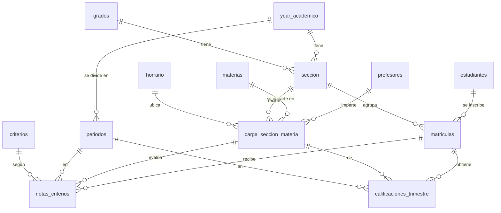

# Sistema Académico de Calificaciones (PostgreSQL)

Base de datos en **PostgreSQL** para gestionar la vida académica de un centro educativo: años escolares, grados, secciones, estudiantes, profesores, materias, horarios, períodos (trimestres) y calificaciones. La lógica de negocio vive en la base de datos: un **trigger** calcula el promedio de cada trimestre, un **procedimiento almacenado** registra las notas con validaciones y una **función** genera el boletín del estudiante.

## Qué demuestra este proyecto

- Modelado relacional de **13 tablas** con claves primarias, foráneas, restricciones `UNIQUE` y `CHECK`.
- Reglas de negocio en la base de datos, por ejemplo: una sección no puede tener dos materias a la misma hora el mismo día.
- **Trigger** (`trg_actualizar_promedio`): cada vez que se inserta o modifica una nota, recalcula el promedio ponderado del trimestre y lo guarda con un *upsert* (`ON CONFLICT ... DO UPDATE`).
- **Procedimientos almacenados**:
  - `sp_inscribir_estudiante(id_estudiante, id_seccion)`: matricula a un estudiante en una sección.
  - `sp_calificar_estudiante(id_estudiante, id_materia, año, periodo, id_criterio, nota)`: valida la nota (0–100), el año, el período, la matrícula y la carga académica, y registra la calificación.
- **Función** `fn_ver_boletin_estudiante(id_estudiante, año)`: devuelve el boletín con la nota de cada trimestre, el promedio final y la letra (A, B, C o F).
- **Transacción automatizada** en PL/pgSQL que busca un estudiante sin notas y lo califica en todas sus materias, períodos y criterios.
- **Datos de prueba**: 386 estudiantes, 60 profesores, 8 materias, 6 grados y años escolares de 2015 a 2026, con 1,827 matrículas.

## Criterios de evaluación

| Criterio | Peso |
| --- | --- |
| Exámenes parciales | 40 % |
| Prácticas y tareas | 30 % |
| Participación oral | 20 % |
| Asistencia y valores | 10 % |

## Modelo entidad-relación



El diagrama detallado con todas las columnas está en [`diagrama_actualizado.dbml`](diagrama_actualizado.dbml) y se puede abrir en [dbdiagram.io](https://dbdiagram.io).

## Estructura

```
├── 1_diagrama/                          # Diagrama inicial del modelo (dbdiagram.io)
├── 2_esquema/create_table.sql           # Creación de las 13 tablas
├── 3_procedimiento_trigger_funcion/
│   ├── 1_tregger.sql                    # Trigger que recalcula el promedio trimestral
│   ├── 2_procedimiento_almacenado.sql   # sp_inscribir_estudiante y sp_calificar_estudiante
│   ├── 3_funcion.sql                    # fn_ver_boletin_estudiante
│   └── Call.sql                         # Ejemplo: califica a la estudiante con ID 118
├── 4_datos_de_prueba/insert_db_prueba.sql
├── 5_transaccion_para calificar/transaccion_calificar.sql
├── diagrama_actualizado.dbml            # Diagrama del esquema actual
└── docker-compose.yml                   # PostgreSQL + pgAdmin listos para usar
```

## Cómo ejecutarlo

### Opción 1: con Docker (recomendado)

Requiere [Docker Desktop](https://www.docker.com/products/docker-desktop/).

```bash
git clone https://github.com/FortunaEdgar/sistema-academico-calificaciones.git
cd sistema-academico-calificaciones
docker compose up -d
```

Docker crea la base `calificaciones` y ejecuta en orden el esquema, el trigger, los procedimientos, la función y los datos de prueba.

- **pgAdmin:** http://localhost:8080 (usuario `admin@admin.com`, contraseña `admin`). Registra un servidor con host `postgres`, usuario `postgres` y contraseña `postgres`.
- **Conexión directa:** `localhost:5432`, base `calificaciones`, usuario `postgres`, contraseña `postgres`.

### Opción 2: PostgreSQL instalado

Crea una base de datos vacía y ejecuta los scripts en este orden desde pgAdmin o `psql`:

1. `2_esquema/create_table.sql`
2. `3_procedimiento_trigger_funcion/1_tregger.sql`
3. `3_procedimiento_trigger_funcion/2_procedimiento_almacenado.sql`
4. `3_procedimiento_trigger_funcion/3_funcion.sql`
5. `4_datos_de_prueba/insert_db_prueba.sql`

## Ejemplo de uso

Registrar una nota (estudiante 118, materia 2, año 2026, trimestre 1, criterio 1, nota 90):

```sql
CALL sp_calificar_estudiante(118, 2, 2026, 1, 1, 90);
```

Después de ejecutar `Call.sql`, el boletín de la estudiante 118 en 2026 queda así:

```sql
SELECT * FROM fn_ver_boletin_estudiante(118, 2026);
```

| Asignatura | T1 | T2 | T3 | Final | Letra |
| --- | ---: | ---: | ---: | ---: | :---: |
| Ciencias Sociales | 86.30 | 89.90 | 94.30 | 90.17 | A |
| Ciencias de la Naturaleza | 80.60 | 87.40 | 92.70 | 86.90 | B |
| Educación Artística | 86.10 | 91.10 | 95.10 | 90.77 | A |
| Educación Física | 95.20 | 96.70 | 99.20 | 97.03 | A |
| Formación Integral, Humana y Religiosa | 88.50 | 92.50 | 96.10 | 92.37 | A |
| Inglés | 90.60 | 94.10 | 98.10 | 94.27 | A |
| Lengua Española | 87.00 | 85.10 | 92.50 | 88.20 | B |
| Matemáticas | 78.40 | 84.80 | 90.10 | 84.43 | B |

Para calificar automáticamente a un estudiante que aún no tiene notas, ejecuta `5_transaccion_para calificar/transaccion_calificar.sql`; el mensaje final indica a quién calificó.

## Tecnologías

PostgreSQL 16 · PL/pgSQL · pgAdmin 4 · Docker Compose · dbdiagram.io

## Autores

Proyecto final de la asignatura Base de Datos II (UFHEC), desarrollado en equipo por cuatro estudiantes de Ingeniería de Software:

- **Edgar Antonio Yan Fortuna**
- Tres compañeros de clase (nombres reservados)

Contacto de Edgar:
[GitHub](https://github.com/FortunaEdgar) · yanedgar3@gmail.com
